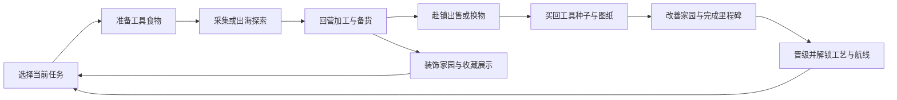

# 晴耕雨航：孤岛生活与城乡贸易产品方案 v1

日期：2026-11-11。状态：产品设计与路线图；当前已实现范围以《实现说明与验证》为准；本文中的时间、价格、收入与指标均为待验证假设，不代表已有运营结果。

## 1. 产品决策

一句话：玩家独自在孤岛谋生，通过采集、种植、捕鱼和手工制作积累货物，驾船去镇上出售或换物，再将所得投入工具、船只和家园，逐渐建立通往城市的贸易生活。

首发假设：Android / iOS 横屏，Godot 4.x，低多边形 3D、斜俯视镜头，单人游玩；PC 键鼠用于开发验证。目标是喜欢探索、建设、收集的轻中度玩家，每次玩 8—15 分钟。平台与受众是假设，尚未由用户指定。

生存提供当下目标，亲手劳作创造货物，城乡贸易赋予劳动价值，任务带来能力成长，家园改善体现积累成果。灯塔与群岛故事作为探索支线承接。游戏内商业是核心玩法；开发者盈利另由外观商品验证，不把真实充值设为贸易起步条件。

首版不做多人服务器、PVP、开放世界无缝航行、随机抽卡、付费战力或大型自动化工厂。先用小规模手工设计的岛屿验证玩法。

## 2. 项目现状与本轮边界

本工作区已有 `cuiyu-islands/project.godot`，入口为 `scenes/island_main.tscn`，已有程序化岛屿、采集、动物互动、小船、剧情和基础背包。`scripts/autoload/game_manager.gd` 当前承担剧情、资源、图鉴；未看到完整任务晋级与交易系统。

项目现已新增 `scenes/life_main.tscn` 作为《晴耕雨航》入口，旧场景保留。已实现基础生活、时间、任务和贸易切片；本文件其余详细规则仍含路线图，具体差异见 [实现说明与验证](实现说明与验证.md)。充值与实际盈利尚未实现。

## 3. 玩家循环



短循环 30—90 秒：发现资源 → 接近 → 工具动作 → 获得资源 → 看到任务进度。

单次循环 8—15 分钟：选择一个目标 → 准备 → 探索 → 安全回营 → 完成一项可见建设。

长循环：建立稳定生存能力 → 修船 → 首次赶集 → 学习加工和接订单 → 改善工具与家园 → 扩大货运 → 进入城市市场。探索新岛提供新原料，修复灯塔开辟新航线；岛屿始终是家和生产基地。

## 4. 任务驱动晋级

不使用反复采集刷经验作为主晋级条件。等级由一组生存能力里程碑决定，完成全部必要条件后在营地领取晋级；支线和日常不阻塞主线。

| 阶段 | 核心问题 | 必做任务 | 晋级后的新能力 | 节奏假设 |
|---|---|---|---|---|
| R1 漂流者 | 今晚如何活下来 | 收集漂流木、石头，生火，获得饮水 | 篝火烹饪、任务板 | 前 10 分钟 |
| R2 扎营者 | 如何稳定生活 | 制作石斧，搭庇护所、储物箱，度过一夜 | 工作台、集雨器、营地装饰 | 首日 20—40 分钟累计 |
| R3 自给者 | 如何把余粮换成改善生活的工具 | 建造集雨器，备好口粮，修船并完成首次赶集 | 港口小镇、林地岛、种植床 | 累计 1—2 小时 |
| R4 探索者 | 如何靠手艺获得更好回报 | 从林地带回树脂，完成首张加工品订单与一次以物易物 | 进阶工作台、树脂密封船体、礁石岛 | 第 2—3 天 |
| R5 建设者 | 如何安全走得更远 | 礁石岛采铁、制作铁工具、加固营地 | 抗风船帆、风暴岛远征 | 第 4—7 天 |
| R6 守岛人 | 群岛为何失联 | 找回灯塔组件、修复航标、完成风暴远征 | 主线结局、收藏目标、装饰主题 | 首批内容第 2 周以后 |

以上是内容节奏目标，玩家可提前推进，不设置现实日期锁。R4—R6 是扩展路线，不属于第一个可玩版本。

任务类型：主线引导新能力；支线讲述岛屿故事并奖励装饰；日常委托奖励普通货币与少量补给；探索成就记录长期收藏。每个工作日清晨提供 3 个任选营地委托（规划功能），完成 2 个拿满该游戏日主要奖励，无连续签到清零惩罚。委托奖励量按游戏日频率调参，睡眠跳日不会累计发放错过的委托奖励；现实日期的商业活动独立计时。

任务数据必须区分：

- `collect`：任务激活后累计采集事件，已花掉的材料仍计数。
- `possess`：提交时检查背包，提交后原子扣除；界面明确“交付材料”。
- `build`：检查已建建筑，接任务前建成的建筑也算；拆除后未领取条件重新计算。
- `visit` / `discover`：记录历史访问与发现，先探索后接任务同样有效。
- `rank`：领取晋级时重新验证条件，解锁永久能力。

状态：锁定 → 进行中 → 可领取 → 已领取。奖励以 `quest_id` 保存领取标记；重复点击、退出重进不重复发奖。建造、制造、领取必须一起更新资源与存档；失败可重试，不丢材料。每个任务说明下一步去哪、缺什么、完成后有什么变化。

## 5. 前 30 分钟具体体验

| 时间 | 玩家行动 | 系统反馈与结果 |
|---|---|---|
| 0—2 分钟 | 海滩醒来，拾取 3 木材、2 石头 | 无长篇强制对白；看到篝火配方与目标位置 |
| 2—5 分钟 | 用材料点燃篝火，拾取应急椰子并饮用 | 解决第一个需求，晋级 R1；营地开始有光 |
| 5—10 分钟 | 再采 3 木、2 石制造石斧，砍树 | 工具改变可采集对象，木屑、音效、资源反馈 |
| 10—18 分钟 | 建庇护所与储物箱，烹饪食物 | 营地可安全休息，背包压力有解决办法 |
| 18—22 分钟 | 选择休息，度过首夜并领取 R2 | 不要求等待完整昼夜；预览船只修复和集雨器 |
| 22—30 分钟 | 找纤维、造集雨器、准备修船 | 明确下一次登录目标，完成一段闭环可随时退出 |

前 10 分钟不弹商店或广告。首次营地完成后，可在装饰页主动查看商品预览，不自动弹付费窗口。

## 6. 生存、采集与失败恢复

首版只显示生命、饱食、饮水；体力只约束短时奔跑和工具动作，数秒恢复，不是限制登录次数的付费体力。

初始饱食、饮水均为 100。原型调参起点：在线每分钟饱食 -2、饮水 -3；食物与水的收益在工具提示中明确。低于 25 提醒，归零后逐步扣血；死亡前必须有充足可感知的挽救时间。离线与菜单暂停不消耗生存数值。

出生海滩有可再生的低效食物和饮水来源，基础资源定时恢复；主线关键道具保证获得，随机掉落仅用于额外收藏。装备损坏后可用普通材料修复，不会永久丢失。

死亡：返回营地，损失本次远征中 20% 的普通采集材料，任务道具、工具、货币、外观保留；遗失材料可回到背包点取回。新手首次远征不掉落。免费复活始终可用，不售卖复活服务。

岛屿天气影响路线与准备：雨天利于集水，夜间降低视野，远岛风暴要求更好船帆。昼夜、日常作息和四季属于核心产品规则，具体见第 14 节。首个切片建立完整时间与四季状态，复杂疾病、腐败与基地袭击暂不开发。

## 7. 资源与制造经济

| 资源层 | 获取 | 消耗 | 设计目的 |
|---|---|---|---|
| 木材、石头、纤维 | 近营采集，可再生 | 工具、基础建筑、修复 | 支撑前期学习 |
| 浆果、椰子、鱼、清水 | 野外、烹饪、集雨、捕鱼 | 远征生存 | 让准备有意义 |
| 树脂、铁矿 | 林地岛、礁石岛 | 船体、进阶工具 | 让探索改变能力 |
| 遗迹组件 | 固定任务与探索节点 | 灯塔主线 | 保证目标与叙事推进 |
| 贝币 | 镇上出售货物、订单、委托 | 种子、工具、图纸、运费、修理与普通装饰 | 劳动收入与再投资；不用真实充值购买 |
| 付费权益 | 真实购买的明确商品 | 外观所有权 | 首版直接定价，减少货币层级 |

起始配方（待试玩调整）：篝火 3 木+2 石；石斧 3 木+2 石；庇护所 8 木+6 纤维；储物箱 6 木；集雨器 8 木+4 纤维；修船 12 木+8 纤维；熟食消耗食材并使用篝火。前 10 分钟至少可获得 12 木、8 石和应急食物，避免串行任务耗尽必需品。

普通背包 20 格，每种基础材料每格 50 个；任务物品单独存储，营地仓库通过游戏内建造扩展。满包时说明原因，可转存或丢弃；制造先验证扣料后容量再执行，不发生材料扣除但产物消失。

真实付费商店不出售木材、铁矿、贝币和主线组件，不制造资源瓶颈再收费解锁。游戏内镇上商人可以用贝币买卖普通原料、工具和生活物资，具体见第 15 节。中后期用新工艺、营地修缮与生活改善消耗资源；避免仅把同一个配方数量扩大十倍。

## 8. 留存与展示

第 1 天：篝火、庇护所形成“这是我的家”的可见变化；第 2 天：第一次出海，带回改变制造能力的材料；第 3—7 天：营地主题、钓鱼收藏、灯塔故事逐步展开。

离线时世界日历、生存需求、天气与作物暂停，不发生换季、死亡或袭击损毁。首版不做离线产出，避免与游戏内作息冲突；未来若增加离线补给，使用独立且有上限的补给箱，不推进日历、作物生长或季节任务。

装饰可旋转、摆放、预览、拍照，商店预览直接展示在玩家营地中。初期用截图分享和 NPC 到访建立展示价值；好友参观放到留存得到验证后，避免提前承担联网成本。

## 9. 盈利模式

建议以免费游玩 + 明码标价外观为主。首测验证一次性主题包的购买意愿；内容生产稳定后再上线通行证。当前方案不接广告，避免广告奖励替代劳动收入。

| 商品 | 测试价（人民币参考） | 内容 | 出现位置 | 实施阶段 |
|---|---|---|---|---|
| 首航纪念包 | ¥6 | 航海服配色、营地旗帜、纪念称号 | R2 后主动进入装饰页 | 首次商业测试 |
| 主题营地包 | ¥18—30 | 一套篝火、帐篷、仓箱、灯具视觉主题 | 营地摆放预览 | 主力测试商品 |
| 船只外观包 | ¥12—30 | 帆、船身配色、纯视觉尾迹 | 修船后预览 | 探索玩法完成后 |
| 28 日航海手册 | ¥30 | 免费轨道 + 付费外观轨道，购买时可见全部奖励 | R3 后主动查看 | 有持续内容能力后 |

不卖攻击、航速、生产倍率、主线资格或额外生存机会。宠物若后续售卖，只改变外观与陪伴表现，资源能力与免费宠物一致。

通行证以常规游玩获得进度，主线与日常委托都能推进；目标是每周约 3 小时、4 周可完成。已达成但未领取的奖励自动补发，支持后期购买追溯解锁；具体追赶机制必须通过完成率测试再定，不在 MVP 承诺季更内容。

当前不采用激励广告发贝币或生产资源；商业验证先聚焦外观购买。贸易所得贝币与付费权益分开，详细规则见第 15 节。

首测先做普通主题包和不接真实支付的商品预览，观察查看、试穿和购买意向；真实付款仅在订单校验、恢复购买、退款撤销权益与可见错误恢复完成后开放。原型标注“测试商品”，不能伪装成功扣款。

## 10. 盈利测算：假设与公式

口径：按月、人民币；内购先用 30% 平台费用作预算占位，实际按发行渠道、资格与协议替换。广告 eCPM 使用开发者结算净口径。以下没有行业均值含义。

```text
月内购流水 = MAU × 月付费率 × 月ARPPU
内购预算净额 = 月内购流水 × (1 - 退款率) × (1 - 渠道费率)
广告预算净额 = DAU × 30 × 人均每日实际完成曝光 × 净eCPM / 1000
经营贡献 = 内购预算净额 + 广告预算净额 - 服务器/工具 - 内容/人力 - 当月买量支出
```

| 假设 | 保守 | 中性 | 乐观 |
|---|---:|---:|---:|
| MAU | 10,000 | 10,000 | 10,000 |
| DAU | 1,500 | 2,000 | 2,500 |
| 月付费率 | 1% | 3% | 5% |
| 月 ARPPU | ¥25 | ¥35 | ¥45 |
| 月内购流水 | ¥2,500 | ¥10,500 | ¥22,500 |
| 退款占位 | 3% | 3% | 3% |
| 扣渠道与退款后的内购 | ¥1,697.50 | ¥7,129.50 | ¥15,277.50 |
| 每 DAU 每日实际广告曝光 | 0 | 0 | 0 |
| 净 eCPM | 不适用 | 不适用 | 不适用 |
| 广告净额 | ¥0 | ¥0 | ¥0 |
| 收入合计（未扣运营成本） | ¥1,697.50 | ¥7,129.50 | ¥15,277.50 |

这说明 1 万 MAU 未必支撑持续开发。若每月内容/人力 ¥15,000、服务器/工具 ¥1,000、无买量，中性模型仍亏约 ¥8,870.50；仅在收入效率保持不变的假设下，约需 22,442 MAU 覆盖这 ¥16,000 固定成本。规模增加时内容、人力和服务成本可能同步增长。

30 日贡献 LTV = 同一新增用户群在前 30 日产生的净收入减变动服务成本，再除以该群新增人数；不能用上述月均 MAU 收入代替 cohort LTV。先测自然用户，只有实际 cohort LTV 明显高于 CAC 且回收期可承担时才扩大买量。不把愿望定价当作盈利证明；税费、获客与其他实际成本需补入预算。

## 11. 素材与交互参考的使用边界

已于本轮通过网站页面、公开 API 和仓库 README 检查参考；搜索工具返回 403，改用直接读取原站内容。

- [Polyfork 素材库](https://polyfork.dev/assets)：GLB 可用于 Godot；低多边形版本与 HD 版本的权限不同，首版使用低模。已查询到 [Campfire](https://polyfork.dev/asset/campfire-4390aa) 和 [Chilean Palm](https://polyfork.dev/asset/chilean-palm-45fef5)，作为候选，不代表已经导入或通过视觉验收。优先从同主题套件挑建筑、船、植被，统一比例和颜色。
- [Polyfork 授权页](https://polyfork.dev/licensing)：当前免费低模网格可选择 CC BY 4.0 或其自身许可。项目默认记录资产 ID、来源、下载日期、许可和修改，并在鸣谢中署名；每个实际采用文件保留对应许可证据。不能把“网页显示免费”理解为所有源代码、缩略图或 HD 内容均可任意再发布。
- [PixelFX 仓库说明](https://github.com/patch-gg/pixelfx)：支持导出精灵表用于 Godot；JS 模块不直接作为 GDScript 使用。借鉴动作的蓄力、接触反馈与恢复节奏。实际打包前核对项目及所用效果的许可证和来源；本轮尚未完成该授权核查。

| 操作 | 动作与反馈 | Godot 实现方向 |
|---|---|---|
| 采集 | 目标描边 → 工具蓄力 → 接触木屑/石屑 → 数量提示 | 动画事件触发收益，特效与收益不得各结算一次 |
| 建造 | 透明预览 → 合法绿/非法红 → 确认 → 尘土散开 | 世界放置校验与原子扣料 |
| 领取任务 | 按钮响应 → 图标飞入 → 下个目标出现 | UI 动画不阻塞实际存档 |
| 晋级 | 营地标识变化、短促光圈、展示新能力 | UI 可跳过，永久解锁先保存 |
| 受伤 | 角色反应、轻闪、方向提示 | 可关闭震屏，不用强烈全屏频闪 |
| 环境 | 篝火、水波、雨滴 | 低模 3D + 克制粒子；像素效果先验证风格再采用 |

移动端左侧移动、右侧情境交互；靠近目标自动选择适用工具，支持按住连续采集。任务页仅追踪一个主目标；建造状态禁止误触采集。PC 保留相应键鼠操作。单人打开背包、设置、商店暂停危险；危险状态不推送商业入口。

## 12. Godot 落地模块

保留现有场景，把扩展规则做成数据。`GameManager` 暂做兼容入口，后续按职责拆分，避免一次重构全部 Demo。

| 模块 | 数据与职责 | 关键验收 |
|---|---|---|
| Item / Recipe Resource | 稳定 ID、堆叠、配方、工具和工作台要求 | 名称本地化不影响存档 |
| InventoryService | 增减、转存、制造、容量校验 | 满包和重复操作不吞物品 |
| QuestService | 事件订阅、前置条件、状态、一次性领奖 | 先建后接、交付扣料、重复领奖正确 |
| ProgressionService | 阶段条件、能力与航线解锁 | 任务未完成不能越级，解锁可恢复 |
| SurvivalController | 在线需求、受伤、休息与复活 | 暂停/离线不误扣，失败能继续 |
| WorldClock / Calendar | 游戏分钟、日期、四季、统一时间推进与暂停 | 睡眠跨日和跨季只结算一次 |
| Routine / Weather | 精力、睡眠、日程、季节天气与预报 | 营地休息安全，预报读档不重抽 |
| Trade / Order / Route | NPC 报价、库存、换物、订单、货舱与往返 | 成交原子扣货发款，往返不软锁，读档不刷新套利 |
| BuildingService | 占位、碰撞、旋转、材料校验 | 失败不扣料，拆除规则可见 |
| SaveService | 存档版本、世界/任务/背包/建筑、备份恢复 | 重启状态一致，损坏可恢复 |
| EntitlementService（商业测试期） | 商品、订单、已拥有外观与恢复 | 支付取消不发奖，校验幂等 |

核心事件：`resource_collected`、`item_crafted`、`building_placed`、`island_visited`、`quest_claimed`、`rank_unlocked`。每个事件带来源与稳定对象 ID；历史事实与当前持有量分别保存。制作、任务奖励与解锁使用同一事务结果存档，不依赖 UI 动画结束才保存。

离线单人可接受玩家自行修改普通资源；真实付费权益以后端验证或平台可靠机制管理，不能仅信任本地按钮。首版仅定义接口，不提前搭建复杂账号和付费后台。

## 13. 分阶段交付与验证

P0 产品逻辑：本文件；规则、经济、商业假设可审阅。

P1 可玩闭环：一座出生岛，R1—R2，采集、制造、建造、饮食、昼夜、睡眠、首夜、存档；建立四季日历并为每季配置至少一种资源差异、一种天气和一项生活准备目标。提供开发用快进以验证完整一年，退出重开保持状态。选择约 10—15 个 Polyfork 候选模型，逐个通过 Godot 导入与场景观感验证；不以“能导入”作为美术验收。

P2 劳作贸易切片：加入港口小镇、林地岛与 R3，修船后完成“备货 → 航行 → 出售 → 换物 → 买工具 → 返岛”的一次完整往返，加入加工订单与失败恢复；证明劳动收入能改善生产和生活。完成移动端真机触控、帧率、发热与读档验证。

P3 小规模测试：装饰摆放、主题预览与购买意向埋点；玩家理解付费价值后再接真实商店。测试设备和用户同意流程准备完成后采集数据。

P4 留存成立后扩展：R4—R6、城市市场、跨季订单、收藏与主题内容，再评估航海手册与好友参观。

首轮招募 20—50 人做定性试玩，记录是否理解任务、在哪里迷路、首次建造和首次失败的反应；不凭这个样本下商业化结论。量化留存、付费和广告需更大样本，并报告样本量和不确定性。

建议内部试验门槛（非行业基准）：首个篝火完成率 ≥80%，首营完成率 ≥60%，D1 ≥35%，D7 ≥12%；未达到则先修节奏和操作。D1/D7 按同一安装 cohort 在第 1/7 天回访计算，过滤开发测试账号。

埋点至少包含新档开始、引导步骤、任务进度/领奖、晋级、制造失败原因、死亡、首航、回营、存档恢复、商品展示/预览/购买/退款、广告请求/填充/完成/发奖。商业指标区分查看转化、实际支付和退款，不把点击“想购买”当作收入。

放量条件：观察到可复现留存与付费、至少完整 30 日 cohort 的贡献 LTV 和真实获客成本；同时有能力持续交付已承诺内容。否则收缩到完成度高的一次性购买版本，并以独立测试验证该定价，避免长期内容承诺拖垮小团队。

## 14. 日常作息、白天黑夜与四季（新增核心需求）

### 14.1 时间尺度

采用游戏内日历，不与手机时间和现实四季绑定。正常速度下 1 游戏日为 24 现实分钟，1 游戏小时为 1 现实分钟；每周 7 游戏日，周一至周五工作、周六周日双休。每季暂定 14 游戏日（两个完整工作周与周末），一年 56 游戏日；新档春季第 1 日为周一。全部参数可配置，先通过试玩验证节奏。HUD 显示“第 1 年·春季第 3 日·周三 16:20”、天气、日落倒计时和精力。

新档从春季第 1 日 08:00 开始。新手首日以任务驱动时段：完成取水、生火、庇护所引导后才进入首夜，避免玩家还不会操作就天黑。首夜休息后转为正常时钟。前文“第 2—3 天”等成长目标指现实游玩日，不是这个世界日历；主线仍无现实日期锁。

离线、切后台、背包、任务全屏页、设置、商店暂停世界；屏幕上的简短任务追踪不暂停。睡眠通过同一个时间推进入口快进，不能只改变天空颜色。任何跨日、跨季结算按经过的边界依次执行并存档。

### 14.2 一天的生活节奏

下表以春秋为例，是系统提供的生活机会，不是要求玩家准时打卡。

| 游戏时间 | 作息建议 | 玩法变化 |
|---|---|---|
| 06:00—08:00 清晨 | 起床、吃早餐、取水、照料作物 | 更新预报和营地委托；晨间鱼类与动物活跃 |
| 08:00—12:00 上午 | 伐木、挖矿、出海 | 视野清晰，适合远行与主线探索 |
| 12:00—14:00 午间 | 吃饭、短休、整理背包 | 夏季暴晒时适合遮阴休息；也可继续行动 |
| 14:00—18:00 下午 | 探索、返航、建造 | 任务提示估算返程时间，接近日落提醒携灯 |
| 18:00—22:00 傍晚与夜晚 | 烹饪、修理、装饰、钓夜鱼 | 灯火扩大可见范围，夜间生物和收藏出现 |
| 22:00—次日 06:00 深夜 | 睡觉或准备充分后夜探 | 精力下降更快，远岛风险升高，营地仍安全 |

吃饭恢复饱食，喝水恢复饮水，睡眠恢复精力，三者用途分开。日程板可以勾选“今日采木 / 修船 / 夜钓”，不勾选不惩罚。动物按时段觅食、休息；后续 NPC 有可查询的日程，玩家可留下委托，不因错过见面阻塞主线。

### 14.3 精力与睡眠

精力为长期清醒状态，范围 0—100，与数秒恢复的动作体力分开。调参起点：普通清醒每游戏小时消耗 3 点，22:00—06:00 每小时消耗 5 点；工具动作仍只消耗短期体力。精力低于 30 预警，低于 15 降低动作体力恢复速度；归零不能奔跑但仍可走路和返营，不直接强制昏倒丢物。

18:00 后可在庇护所选择“睡到次日 06:00”，显示将经过的时间和次日天气；至少睡满 6 游戏小时恢复至 100，不足则按小时比例恢复。白天可短休 2 游戏小时恢复 20 精力。无庇护所时可在安全篝火旁短休，保证玩家始终有恢复路径；不售卖精力药或付费睡眠。

睡眠期间暂停饥渴与受伤结算，不出现“睡觉跳过一夜直接饿死”。作物、集雨、制造按经过的游戏时间与预定天气结算；不模拟离线生产。起床显示昨天完成的建设、当前补给和今日机会。

### 14.4 四季改变准备与目标

世界采用有明显四季的架空海洋群岛，美术随季节调整植被、海色、光照、音景和部分地表；基础物件复用，不能仅依赖全屏滤镜表现换季。冬季以冷雨、海雾、霜地为主，高处可见薄雪，不强行把全岛棕榈树变成雪林。

| 季节 | 世界与资源变化 | 玩家生活安排 | 季节目标示例 |
|---|---|---|---|
| 春 | 春雨、嫩叶、野花；适合春季作物 | 建集雨器、开种植床、积累基础物资 | 收获首批作物，制作花篱 |
| 夏 | 昼长、晴热、雷雨；热带果实与近海鱼丰富 | 备饮水、建遮阴棚，按预报避开雷雨出海 | 做储水桶，找到夏季鱼 |
| 秋 | 金黄植被、大风、坚果与菌菇；收获季 | 储粮、修船、制作挡风与保温设施 | 储备 6 份口粮，加固屋顶 |
| 冬 | 昼短、冷雨海雾、局部结霜；露天生长变慢 | 做热食、用免费可制作的保暖装备，安排短途探索 | 建暖棚或火炉，发现冬季遗迹线索 |

春秋日出 06:00、日落 18:00；夏日出 05:00、日落 20:00；冬日出 07:00、日落 17:00。光照平滑过渡，夜晚仍能辨路；照明扩大交互可见范围，不以纯黑画面制造难度。

夏季无遮阴时饮水消耗暂定 ×1.25；冬季无保暖时精力消耗 ×1.25，营地庇护可消除对应额外消耗。首版不用复杂实时体温条，后续再评估。最低生存食物、基础水源、木石纤维四季可得，季节特色资源用于支线、装饰或替代配方。主线材料全年有确定来源，冬季不会把晋级任务锁到下一年。

每季第 12 日开始提示换季，并在日历预览接下来 2 日；显示准备清单。提前一个游戏日预报强天气及受影响航线，关键远征保证可用天气窗口；不生成连续封锁全部必要航线的天气。第一次经历冬季时赠送可制作保暖装备的引导配方，缺少准备仍有免费补救任务。

### 14.5 任务、种植与日历的边界

主线逐步教会“吃饭取水 → 睡觉 → 看天气出海 → 准备换季”。R2 要求在庇护所休息；R3 学会查看预报并携带口粮；R4 之后加入跨季准备支线。晋级不强制等冬天或四季全体验。

季节任务围绕生活安排，例如春季播种、夏季储水、秋季储粮、冬季保暖；奖励是普通资源、配方或收藏，错过可在下一年继续。故事关键任务不在换季时作废；季节支线保存已完成步骤，重复奖励以“年份+季节+任务 ID”判重。

每种作物显示适宜季节、生长所需游戏小时和可收获时间。换季前播种须提示跨季影响；首版不让既有作物因换季枯死，只降低不适季生长速度。成熟后不自动腐烂，收获只结算一次。只有已播种、已启动的生产才随睡眠推进，不为跳过的天数凭空发资源。

首版允许玩家通过休息主动推进日历，视为单人时间管理选择；不额外奖励“跳过一天”。观察是否出现只睡觉刷委托的行为，再调整委托奖励和任务内容，不用现实时间锁强迫等待。

### 14.6 与盈利模式的关系

游戏四季随存档推进；28 日商业手册按现实时间计算，两套时钟在 UI 中明确区分。切换季节、睡眠或修改设备时间不得刷新付费权益；真实商业期限以后端或平台可信时间为准。

四季提供春日花园、夏日海滨、秋日丰收、冬日暖屋等主题装饰机会，但保暖、防晒、储水和航行能力全部免费制作。季节主题商品全年可预览和购买，不因当前存档进入冬季就制造付款倒计时。付费外观可在任何季节使用，火炉皮肤与免费火炉能力一致。

### 14.7 实现与验收

日历保存绝对游戏分钟、年份/季节推导规则版本、已结算日期、天气随机种子和预报、精力、作物/生产起止时刻；日期由统一时间源推导，避免季节和日期各自递增产生冲突。事件增加 `time_period_changed`、`day_started`、`season_changed`、`sleep_completed`。睡眠跨越的每个日界与季界只触发一次，跨年正确回到春季。

开发验证覆盖：新手首夜保护、正常昼夜完整循环、夜间辨路、睡眠跨日跨季跨年、读档预报不变、后台和菜单不推进时间、成熟作物不重复结算、冬季仍可完成主线。通过开发快进查看四季画面与资源变化；真机分别检查白天、雨夜与冬季海雾下的交互辨识和性能，不能用快进测试代替正常节奏试玩。

## 15. 一个人的劳作与城乡贸易（核心方向修订）

### 15.1 生活愿景与劳动价值

核心体验是“靠自己把日子过好”：开始住草棚、徒手捡拾；后来能吃上热饭、睡木床、使用好工具；再后来拥有稳定的菜地、工坊和运输船，在镇上有熟客，在城市能接到认可手艺的订单。

角色始终需要亲自规划和劳动。采集有工具动作，种植有播种照料收获，捕鱼有选位置和时段，加工有选配方与备料；不堆重复点击。按住可连续操作，已完成的基础能力可逐步省事：水桶减少取水次数、好斧减少砍伐次数、推车改善运输。效率来自游戏内积累，不售卖生产倍率。

辛苦体现为时间、精力、材料和运力的取舍，也必须看得见回报。一次劳作的目标是买得起一项小改善，数次往返能获得一项明显改善，不能连续劳动几天只够修工具。

### 15.2 岛、镇、城各自的作用

| 地点 | 玩家做什么 | 提供什么 | 解锁方式 |
|---|---|---|---|
| 自家孤岛 | 求生、采集、种植、捕鱼、加工、休息 | 原料、货物、家园与低成本生活 | 开局 |
| 港口小镇 | 赶集、摆摊、卖货、换物、买工具、接小订单 | 日用品、种子、基础图纸、熟客关系 | 修复小船和首次航行任务 |
| 沿海城市 | 向餐馆和工坊供货、交高品质订单、学习进阶工艺 | 高级图纸、特殊工具、稳定供货合同 | 小镇贸易里程碑与船舱升级 |

小镇先做一个码头加集市的小场景，包含鱼贩、杂货铺、木匠和订单板。城市后续做可步行的紧凑贸易街区，不先开发大都市模拟。城市更看重加工、品质和履约，不是把所有物品售价统一翻倍。

### 15.3 一次具体的劳动与赶集

示例仅用于验证规则，价格、耗时、产量均待试玩调整：

1. 清晨吃早餐、取水，查看小镇公告：“今天需要鱼干”。
2. 上午捕到 8 条普通鱼，保留 2 条作生活口粮。
3. 其余 6 条加工成鱼干，下午装入货舱，确认返航物资。
4. 小镇鱼贩当前仍有 6 份需求，以每份 15 贝币收购，收入 90。
5. 用其中 4 份鱼干履行换种子的交易时，这 4 份便不能同时出售；界面让玩家在“卖钱”和“换物”之间分配数量。
6. 若全部卖出，花 10 贝币购买本次加工使用的盐、8 贝币补充公共码头费用；90-10-8=72 贝币为本次简化现金结余，尚未计工具损耗、自用口粮和劳动时间。初期无强制现金航行费用，这 8 贝币是使用付费装卸服务的示例，可自行装卸节省。
7. 花 40 贝币购买种子，余下 32 留作工具升级；返岛种植，为下一次赶集准备不同货物。

UI 分别显示销售收入、实际支出和现金结余；“利润”还需计入购入原料、消耗品与工具损耗。自采原料不等于没有机会成本，卖原鱼和做鱼干的单位劳动回报需要比较。

### 15.4 生产链与收入成长

| 生计 | 起步货物 | 进阶加工 | 收入成长的来源 |
|---|---|---|---|
| 捕鱼 | 鲜鱼 | 鱼干、熏鱼、餐馆食材箱 | 保存、时段鱼种、订单匹配 |
| 种植 | 蔬菜、果实 | 果酱、腌菜、种苗 | 季节规划、照料品质、配方 |
| 木工 | 木材 | 木板、家具、船用构件 | 工具效率、工艺、定制订单 |
| 采集 | 纤维、野花、菌菇 | 绳索、花束、染料 | 原料搭配、季节需求 |

首个贸易切片只做捕鱼和鱼干一条完整链，加一种换物交易。种植与木工再逐步扩展。加工不保证总是赚钱：要看新增材料、时间、库存需求和运输空间；配方页给成本参考，市场页给当前报价。

基础产物可稳定售出，优质产物额外获得少量溢价。品质来自工具、照料、合适时段和工艺，不靠大量随机报废制造损耗。首版不让货物离线腐坏，长航线鲜鱼风险先用透明的保鲜适配规则表示，加入前需另行定义运输损耗。

### 15.5 买卖、换物与订单

直接买卖：NPC 展示收购价、出售价、剩余收购需求和商品库存；成交前预览数量与余额。相同商品同一商人的卖给玩家价格高于收购价，避免原地无限倒卖。

以物易物：固定、可理解的交换，例如 4 鱼干换 1 袋种子、6 木板换 1 套基础修船配件。显示双方实际消耗和获得数量，容量不足时整笔拒绝，不先扣货。换物用于现金不足时的另一条发展路径，不要求先充值或持有高级货币。

订单：列明货物、品质下限、数量、截止游戏日期、报酬与交货地点。首单无期限、无押金；后续限时单可拒绝或取消，失败不扣成负资产，至多损失该订单的额外信誉收益。常规售卖始终可用，不能因为错过订单就无法谋生。

声望来自履约和贸易里程碑，用来解锁更多客户、工艺与城市订单；工具改善与订单种类共同推动晋级，不以反复刷成交次数替代玩法。首版不加复杂还价小游戏和讨价还价技能树。

### 15.6 市场、四季与作息联动

小镇集市 08:00—18:00 营业，夜晚可住宿、整理或找酒馆委托；码头告示牌始终能查次日价格与营业时间。错过营业可免费在码头简陋床位睡到次日，不发生收费住宿导致无钱返岛。

春季种苗、夏季清凉食物、秋季储粮加工、冬季热食与木料都有需求变化，但不能仅靠标签凭空涨价。初版基础收购价 × 季节需求系数（暂定 0.8—1.3）× 品质系数（普通 1、优质 1.2）后按统一规则取整；订单在接取时锁价，普通交易在打开确认页时锁定本笔报价。

需求充足时按标价收购；高价需求用完后清楚提示普通货物可按保底价售给批发商，避免辛苦一船货完全卖不掉。保底价与商店售价、配方产量、换物比率共同检查，不能靠循环兑换无劳动生钱。

商人库存、报价、需求和换物次数按游戏日更新一次并存档，重开交易页或读档不重刷。库存不出售低于保底转售价的可套利商品；补贴只通过有次数标记的新手任务发放。先用可控价格表，不做复杂全局供需模拟。

航行消耗明确的游戏时间，使用统一时钟推进，自动结算到达时的营业状态。出发界面提示预计到达时间、天气、货舱和返程口粮；场景加载本身不额外扣时间。小镇往返初始建议每程 1 游戏小时，城市后续更远；最终按一次赶集能否在正常日程中完成调参。

### 15.7 独自谋生的底线与风险

玩家可以清贫起步，但不能陷入“没钱买粮 → 没力气干活 → 永远没钱”的死循环。自家岛基础食物、水、简易工具和休息始终可免费获得；小船可用基础材料自修，自行装卸和划船不收强制现金费用。货舱与个人背包分开，保留返程补给，不允许自动全卖掉。

不做强制借贷、利息、每日税款和离线租金。远航风险损失普通货物的一部分，并遵循前文任务道具和工具保留规则；第一次赶集保底安全。货物风险、天气和船况在出发前可见，不用随机沉船清空长期积累。

### 15.8 开发者盈利的重新定位

贝币是劳动获得的游戏内收入，不兑现成人民币，不开放玩家间现金交易，也不售卖贝币。真实付费仍可售卖服装、船舶外观、房屋主题和不增加收益的摊位装饰。让玩家先体验凭劳动改善生活，再验证对外观的购买意愿。

不采用“看广告领贝币”，避免广告奖励替代辛苦劳作或改变贸易经济。首个商业测试不接广告；未来若测试，仅考虑不影响生产、贸易收益的装饰体验，不预计该部分收入。第 10 节已按广告收入 0 更新：中性月收入 ¥7,129.50，固定成本 ¥16,000 时缺口 ¥8,870.50，在其他条件不变的假设下约需 22,442 MAU 才能覆盖固定成本。

### 15.9 最小实现与验收

最小闭环：岛上捕 8 条鱼 → 保留口粮 → 加工鱼干 → 装船 → 到小镇 → 卖一部分、换一部分 → 买工具或种子 → 返岛存档。玩家能说明“今天做了什么、卖了多少钱、花了多少钱、生活改善在哪里”。

规则验证：满货舱换物不吞物品；重复确认不重复收款；订单与普通出售不能重复使用同一货物；读档保持需求和交易结果；休息跨日不会重复补贴；穷到零贝币仍能吃饭、休息与返岛；买卖、制造、换物构成的兑换环不存在无劳动正收益。

数据记录：各工种每游戏小时净收入、第一次赶集完成率、返岛率、攒到首件升级工具的时间、基础生活支出占收入比例、订单取消原因。若全部玩家被迫只做同一种货物，先调整订单和配方回报，保留不同劳动路线的可行性。


## 16. 周末双休：劳动与生活的周节奏

周历跟随游戏内时间，不跟随现实日期。周一至周五是主要生产和贸易日，周六、周日默认休息；自由职业角色没有强制考勤，玩家仍可自主劳作，但周末不安排必做生产委托，不因休息扣声望、损失客户或降低晋级评价。

| 星期 | 生活重心 | 示例 |
|---|---|---|
| 周一 | 安排本周生产 | 看天气、选择订单、采购种子 |
| 周二至周四 | 劳作与加工 | 种植、捕鱼、木工、赶集 |
| 周五 | 交货与收工 | 结算订单，备好周末食物，查看本周积累 |
| 周六 | 逛镇与人情 | 周末集市、换物、拜访熟客、休闲垂钓 |
| 周日 | 留在家园生活 | 做饭、布置房间、照料动物、散步，规划下周 |

周五傍晚展示可跳过的周账本：劳动收入、支出、结余、完成的建设和下周目标。不把周末变成新的限时任务清单；集市活动与休闲奖励可在后续周末重遇，不制造错过惩罚。

周末允许睡懒觉，不扣日程评价；玩家可选择正常起床或睡到 09:00，沿用睡眠快进和恢复规则。基本饮食仍需要，但周五提示备餐；基础免费食水与休息路径始终保留。作物不因两天未照料死亡或降低品质，成熟后等待收获；休息日的生产维护可以跳过。

工作日清晨提供 3 个任选生产委托，周末以休闲提示替代，不要求完成。这里覆盖第 4 节“每个游戏日发生产委托”的旧规则。普通订单的截止日只落在工作日，剩余工作日明确显示；跨越双休不消耗履约工作日。节气与作物生长仍按自然游戏日推进，两者分别计时。

小镇周末集市照常开放，普通收购、杂货和免费码头休息全年可用；木匠定制、城市批量交货等工作业务周末暂停，可先寄存货物或提交申请，下个工作日办理。接受订单时就说明营业日，不能到场才隐藏规则。新手首次赶集始终有值班商人完成买卖与换物，不被周历阻塞。

第一阶段只需实现周历标识、工作/休息日委托切换、订单工作日计时、周账本和周末营业规则；休闲活动逐步增加。验收覆盖周五到周一、季末双休到下一季、跨年星期连续、睡眠跳日和存档恢复，确保不重复结算、不把周末扣成订单逾期。

## 17. 独自开局、亲手建房与移动端全屏（当前需求修订）

目标平台明确为 Android / iOS 横屏手游。开局只有一位玩家角色，岛上没有现成房子、完整码头和货箱。四根小木桩标出未来的家，角色独自站在岛上；先找材料、解决第一晚落脚，再把地基、墙、屋顶和室内基本生活逐步建起来。

临时庇护所只是过夜方案，可以在木屋建成前使用；永久木屋才是安家的核心目标。木屋全部完成后隐藏临时帐篷，出现收纳箱；修好船之后才出现可用码头与船。没有同伴自动代劳，所有材料来自玩家采集与制造。

| 建房阶段 | 本阶段材料 | 可见变化 |
|---|---|---|
| 地基 | 木材6、石材4 | 石基与木地板出现 |
| 墙体 | 木材8、纤维2 | 柱、墙、门洞与窗洞出现 |
| 屋顶 | 木材6、纤维4 | 合拢双坡屋顶，形成遮蔽 |
| 木门与床 | 木材4、纤维2 | 木门、床铺与入住标志出现 |

阶段不能跳过，也不能重复扣料。最终设置“木屋已完成”，可在家睡眠，并解锁修船。新增一次性“亲手建成的家”里程碑，放在过夜与航海之间。旧档不清空，阶段状态写入同一份建筑存档。

移动端界面使用铺满视口的3D世界，顶部显示时间、生活状态和背包入口，底部六个触控入口；背包和建房面板按需展开并可收起。开局默认不展开大面板，保留独自一人的空间感。左侧快捷目标显示四步建房进度，并可领取已达成的里程碑。

采用1280×720逻辑基准、canvas_items缩放与expand宽高比，锁定横屏、启用全屏和触摸到鼠标事件的兼容路径；世界背景铺满屏幕，交互控件根据设备安全区域内缩。超宽手机和平板通过锚点与容器适配，不对整个界面做非等比拉伸。触控按钮最小逻辑高度64，列表可滚动，弹窗按钮同步放大；实际物理尺寸与舒适性须在真机确认。

验证比例包含16:9、19.5:9、20:9和4:3平板，并模拟两侧刘海及底部手势区域。模拟布局和渲染通过不代表已经完成Android/iOS打包、系统导航栏行为或真机触控验收。


## 18. 横屏双拇指操作（当前实现）

参考常见MOBA的操作分区，左下为虚拟摇杆，右下为一个大情境交互按钮和奔跑、建造、背包辅助按钮。这里只参考双拇指分工，不复制现有游戏美术，也不把生存玩法改成战斗技能循环。

玩家必须亲自走到材料附近采集，走到房屋附近施工/休息，再走到码头或集市处理出航与交易。移动带转向、步行动画与奔跑动画；靠当前镜头计算移动方向。右侧空白区域拖动环视，按钮、摇杆和抽屉手势互不抢占。

开局仍是一个人从无房到有房；摇杆移动与情境采集是日常劳作的基础操作。工具挥动、资源采空再生、建筑室内移动和完整移动端反馈仍需继续完善。


## 19. HUD减负与信息层级（当前布局）

主场景默认只显示：左上紧凑的精力/饱食/饮水条，中上日期时间与天气，右上背包和菜单，一条当前任务提示，以及左下摇杆和右下三个动作。健康、货币、材料数量和账本进入背包详情；完整日期与四季预报进入日历。

不再常驻顶部横贯大面板、底部六项功能栏、视角归位、手动保存和重复背包按钮。低频功能统一在右上菜单，进入具体功能后只展开一个详情抽屉；关闭或返回恢复游戏控制。暂停时提供清晰的继续入口，查看说明后恢复原本的暂停状态。

普通结果提示4秒后淡出，正常自动存档保持安静；存档失败持续提示。场景不再叠放游戏名、资源名和建房说明等大量悬浮文字，附近的可交互目标使用一个轻量地面高亮，具体动作由右下主按钮说明。

本轮按用户要求只用无窗口测试检查布局边界与逻辑，未打开预览，未声称完成新布局的视觉或手机真机验收。
